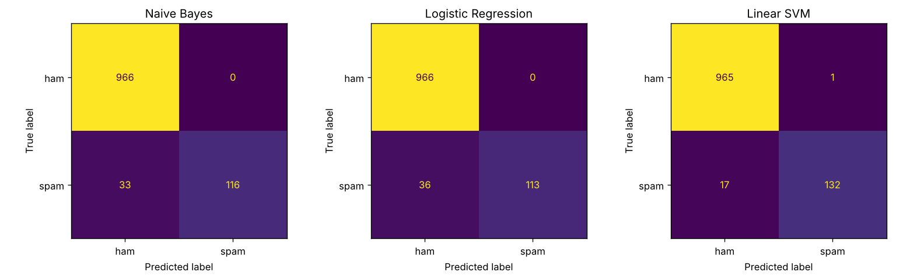

# SMS 스팸 메시지 분류

TF-IDF로 문자 메시지를 수치화하고 분류 모델 3개를 비교한 개인 프로젝트입니다.
정확도만 보지 않고, **어떤 오류를 더 줄여야 하는지 기준을 먼저 정한 뒤** 모델을 선택했습니다.

## 데이터

- [SMS Spam Collection](https://archive.ics.uci.edu/dataset/228/sms+spam+collection) (UCI)
- 문자 5,572개: 정상(ham) 4,825개, 스팸 747개
- 스팸 비율이 13.4%라서, 모든 문자를 정상으로 예측해도 정확도가 86.6%가 나옵니다.
  → 정확도만으로는 모델을 평가할 수 없다고 판단했습니다.

## 진행 과정

1. **데이터 확인**: 정상/스팸 비율, 문자 길이 비교 (스팸 평균 139자, 정상 평균 72자)
2. **전처리**: 소문자 변환, 특수문자 제거, 학습/테스트 8:2 분리 (`stratify`로 스팸 비율 유지)
3. **TF-IDF 수치화**: 불용어 제거, 학습 데이터로만 fit (단어 7,399개)
4. **모델 학습**: Naive Bayes, Logistic Regression, Linear SVM
5. **평가**: Accuracy, Precision, Recall, F1, 혼동행렬
6. **오분류 분석**: 틀린 문자를 직접 읽고 패턴 정리
7. **교차검증**: 데이터를 5번 다르게 나눠 결과가 우연이 아닌지 확인
8. **가중치 실험**: 스팸에 가중치를 준 모델로 Precision과 Recall의 trade-off 확인

## 결과

| 모델 | Accuracy | Precision | Recall | F1 | 놓친 스팸 | 막힌 정상 |
|---|---|---|---|---|---|---|
| Naive Bayes | 0.970 | 1.000 | 0.779 | 0.875 | 33 | 0 |
| Logistic Regression | 0.968 | 1.000 | 0.758 | 0.863 | 36 | 0 |
| **Linear SVM** | **0.984** | 0.992 | **0.886** | **0.936** | **17** | 1 |

정확도 차이는 1.6%p뿐이지만, 놓친 스팸 수는 17개에서 36개까지 2배 넘게 차이가 났습니다.

### 교차검증 (5회)

모델 성능이 특정 데이터 분할에만 의존하는지 확인하기 위해, **학습 데이터 4,457개에 대해서만 5-Fold 교차검증**을 수행했습니다.

TF-IDF와 분류 모델을 `Pipeline`으로 연결하여 각 Fold의 학습 데이터에서만 단어장을 생성하도록 했습니다.

| 모델 | Recall 평균 | Recall 표준편차 | F1 평균 |
|---|---|---|---|
| Naive Bayes | 0.773 | ±0.030 | 0.871 |
| Logistic Regression | 0.689 | ±0.040 | 0.808 |
| **Linear SVM** | **0.906** | **±0.020** | **0.940** |

교차검증에서도 Linear SVM의 Recall과 F1-score가 가장 높았습니다.

**참고:** 위 결과는 학습 데이터에서 수행한 교차검증 결과이며, 별도로 분리한 테스트 데이터 1,115개에서 측정한 F1-score 0.936과는 구분됩니다.

## 모델 선택

- **기준**: 정상 문자를 스팸으로 막는 오류를 더 줄여야 한다고 판단했습니다. 스팸은 들어와도 지우면 되지만, 정상 문자가 막히면 중요한 연락을 놓치기 때문입니다.
- **제외한 모델**: 스팸에 가중치를 준 Logistic Regression(`class_weight="balanced"`)은 놓친 스팸이 36개에서 13개로 줄었지만, 정상 문자 13개를 막아 기준에 따라 제외했습니다.

| 모델 | 놓친 스팸 | 막힌 정상 |
|---|---|---|
| Logistic Regression (기본) | 36 | 0 |
| Logistic Regression (가중치) | 13 | 13 |
| **Linear SVM (기본)** | **17** | **1** |

- **선택**: **Linear SVM**. 정상 문자를 막은 건 테스트 1,115개 중 1개로 거의 유지하면서, 놓친 스팸은 기본 모델들의 절반 이하로 줄었습니다.
- **배운 점**: Recall을 올리면 Precision이 떨어지는 trade-off가 있어서, 어떤 오류를 더 줄일지 기준을 먼저 정해야 합니다.

## 오분류 분석

- **놓친 스팸**: 스팸 단어 없이 일상 대화처럼 쓴 문자, "ringtoneking 84484" 같은 아주 짧은 문자, 일부러 틀린 철자(drvgs, wiv)
- **막힌 정상 문자**: msg, reply처럼 스팸에 자주 나오는 단어가 들어간 짧은 문자

## 개선 방향

- 전화번호를 하나의 특징(`PHONE` 토큰)으로 바꾸기: 놓친 스팸 상당수가 전화번호를 포함
- 글자 단위 n-gram 사용: 틀린 철자도 비슷한 패턴으로 인식

## 실행 방법

Google Colab에서 `spam_classification.ipynb`를 열고 위에서부터 실행하면 됩니다. 데이터는 노트북에서 자동으로 불러옵니다.

## 사용 기술

Python, Pandas, scikit-learn, Matplotlib
